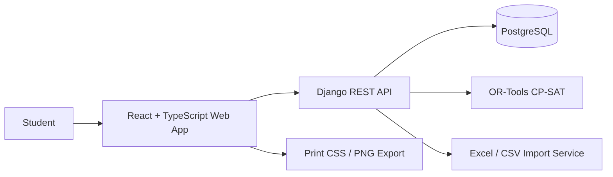
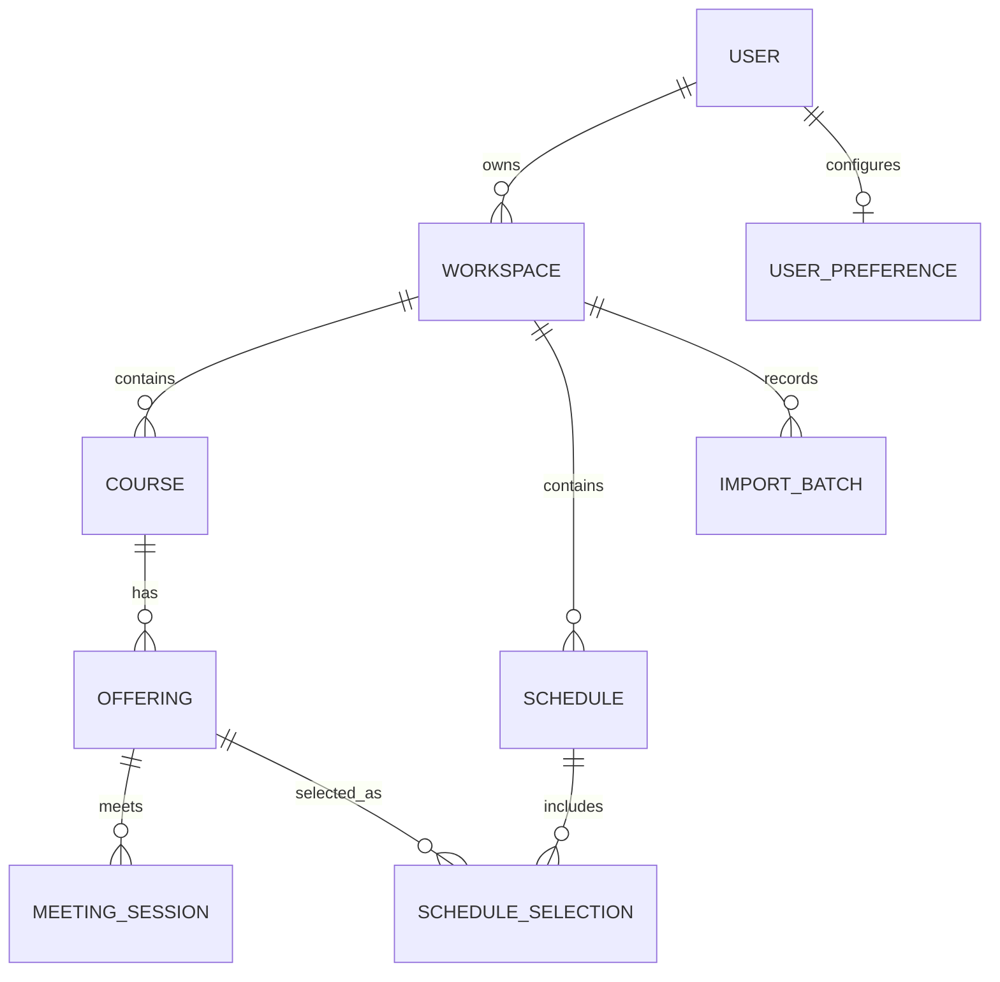

# Student Schedule Planner
## Product Requirements, Technical Architecture, UX Specification, and Development Plan

**Document type:** Master project specification for an AI-assisted coding environment  
**Working product name:** Student Schedule Planner (temporary; do not invent a brand name or tagline)  
**Primary audience:** University and college students, including irregular students  
**Initial operating context:** A student independently organizes the subjects and sections provided to them by their class adviser or department  
**Document status:** Initial implementation specification  

---

# 0. Instructions for the development agent

This document is the source of truth for the first version of the project. Read it completely before creating or modifying application code. Treat the defined scope, workflow, data model, scheduling rules, visual direction, and acceptance criteria as requirements rather than optional suggestions.

Build a polished, working web application from a clean project structure. Do not merely produce a landing page, mockup, static dashboard, or disconnected collection of components. The essential workflows must work end to end: create or import class offerings, organize the subjects the student intends to take, detect conflicts, generate valid schedule alternatives, manually edit and save schedules, and export a timetable.

**Do not add AI features.** This project does not need an AI chatbot, AI assistant, generative recommendations, AI summaries, LLM integration, AI-generated copy, or an AI API key. Schedule generation is a deterministic constraint-solving problem. Use ordinary validation, explicit rules, and an optimization solver. Excel import is structured data import, not AI extraction.

**Do not expand the scope without authorization.** The initial product is only a schedule planner. Do not implement curriculum advising, prerequisite or eligibility evaluation, student records, grades, GWA calculators, assignment management, attendance, campus maps, room directories, announcements, chat, QR scanning, image/PDF timetable OCR, institutional database integrations, Dean approval, enrollment submission, or administrator/registrar workflows. Do not invent a university integration. Students are responsible for entering or importing the subjects and available sections they have been given.

**Keep the product lean.** Do not add placeholder buttons, fake analytics, decorative dashboard cards, fabricated statistics, generic AI-generated callouts, stock-photo illustrations, motivational copy, corny taglines, or features that do not support schedule creation. No empty sections should be presented as though they were functional. Avoid unnecessary dependencies and abstractions.

**Work in verified stages.** First inspect the existing workspace. If it is empty, initialize the project using the stack below. If code already exists, inspect it and preserve valid work unless it conflicts with this specification. Create a short implementation checklist, then build the application in vertical slices. After each slice, run relevant tests and fix errors before proceeding. Do not claim a feature is complete when it is only a visual placeholder.

Before finishing, provide:
1. A working local development setup and exact run instructions.
2. A database migration and a small, clearly labelled demo dataset (never present demo records as real university data).
3. Automated tests for scheduling conflicts, schedule generation, data import, and access isolation.
4. A concise description of the implemented features, known limitations, and any unfinished work.
5. A README explaining setup, environment variables, database migrations, tests, and production deployment considerations.

When a requirement is genuinely ambiguous, choose the simplest implementation consistent with this document, record the decision in the README or a short `docs/DECISIONS.md`, and continue. Do not repeatedly stop to ask the user to decide minor implementation details.

---

# 1. Product definition

## 1.1 Product purpose

The Student Schedule Planner is a responsive web application that helps a student turn subject and section information into a clear, organized, editable weekly class timetable. It reduces the manual work involved in arranging classes, makes overlapping meeting times easy to detect, and can automatically produce several valid schedule combinations when a student has multiple section choices for the same subject.

The application is designed for both regular and irregular students. It does not decide which subjects a student should take. A class adviser, department, or other official source remains responsible for telling the student which subjects they need or are allowed to enroll in. The student enters that information into the planner and uses the application to organize the available schedule options.

The core value is practical: fewer manual scheduling mistakes, easier comparison of possible schedules, and a clean timetable that can be saved, printed, or shared.

## 1.2 Product principles

- **Student-controlled input:** The student owns the subject list and decides which subjects to include.
- **Transparent scheduling:** The application explains detected overlaps and why a generated schedule was ranked highly. It must not make unexplained or authoritative academic decisions.
- **Correctness before cleverness:** A schedule that violates a hard time constraint is not a valid suggestion.
- **Fast manual editing:** A user must be able to add, change, or remove a class without navigating through a complicated wizard.
- **Import with review:** Imported rows are previewed and validated before being committed.
- **One coherent interface:** The same class data powers the timetable, schedule editor, conflict checker, and exports.
- **Aesthetic restraint:** The interface should feel calm, considered, readable, and personal without becoming decorative or cluttered.
- **Responsive by design:** Desktop is the primary workspace for building schedules, but the timetable must remain genuinely usable on phones and tablets.
- **No unnecessary intelligence theatre:** No chatbot, AI language, generated advice, fake insights, or vague claims of automation.

## 1.3 Target users

**Primary user:** A college or university student who has been given a list of subjects and available class sections and needs to arrange them into a workable weekly schedule.

**Important use case:** An irregular student may have subjects from several year levels or sections, different meeting patterns, and several possible class sections. The planner must allow the student to organize this information without assuming that their subjects follow a standard year-level curriculum.

The application may also be used by regular students who want to organize a normal semester timetable. It should not be hardcoded to one university, degree program, year level, or department.

## 1.4 Explicit responsibility boundary

The application is a planning and organization tool, not an official enrollment or advising authority. It may check whether selected class meetings overlap and whether the provided data is complete enough to schedule. It must not claim that a student is academically eligible for a subject, that a subject is officially offered, or that a schedule has been approved by the university.

The application does not need access to the university's internal database. Its initial data sources are:

1. Information manually entered by the student.
2. A structured Excel workbook or CSV file supplied to the student.

---

# 2. Scope

## 2.1 Included in the first product

### Core scheduling
- Create, rename, duplicate, and delete personal schedules.
- Add classes manually.
- Edit a class's course details and meeting sessions.
- Remove a class from a schedule, with a clear undo or confirmation pattern.
- Support multiple meeting sessions per subject or section.
- Support different days, start times, end times, rooms, and instructors for each meeting session.
- Detect time overlaps and explain the exact conflict.
- Show a weekly timetable and a mobile-friendly daily/agenda view.
- Let the user switch which class details are displayed.
- Automatically assign stable, distinguishable subject colors and allow custom color overrides.
- Generate multiple valid timetable alternatives from selected subjects and available sections.
- Let the user compare, select, adjust, and save generated alternatives.
- Export a print-ready PDF through the browser's print flow and export the timetable as a PNG image.

### Structured data input
- Upload `.xlsx` workbooks.
- Upload `.csv` files.
- Select a worksheet when a workbook has multiple sheets.
- Map spreadsheet columns to the application's fields.
- Preview parsed rows before importing.
- Validate required fields and report errors at the row level.
- Group multiple meeting rows into one course section when they share the same course code and section identifier.
- Include a downloadable example workbook/template.
- Allow imported records to be edited manually after import.

### Personal preferences
- Select an overall visual theme.
- Customize the colors assigned to subjects.
- Choose timetable display fields.
- Choose default visible days and visible timetable hours.
- Set schedule-generation preferences.
- Save multiple schedules and distinguish drafts from a preferred/final personal version.

### Basic account and data ownership
- User registration, login, logout, and password change/reset flow as supported by the chosen deployment setup.
- Each account can only access its own imported data, offerings, schedules, and preferences.

## 2.2 Explicitly excluded from the first product

Do not build any of the following in this release:

- AI, chatbots, natural-language schedule generation, LLM APIs, or AI-written explanations.
- OCR, image recognition, photo upload, screenshot upload, or scanned timetable extraction.
- PDF timetable parsing. PDF is an output format only in this release.
- QR scanning or barcode scanning.
- Direct access to a university student information system or internal school database.
- Official course offering feeds or automatic synchronization with a university.
- Curriculum tracking, prerequisite validation, academic eligibility checking, or advice about what subjects the student should take.
- Dean, adviser, department, registrar, or administrator approval dashboards.
- Official enrollment, registration, or payment workflows.
- GWA, GPA, grade, attendance, assignment, task, note, or study-planning modules.
- Campus maps, building navigation, room directories, or faculty directories.
- Social networking, class chat, sharing feeds, or public profiles.
- Native Android, iOS, or Windows applications.

The architecture may be kept extensible, but do not build speculative infrastructure for excluded modules.

---

# 3. Main user workflows

The interface should make the following workflows obvious and short. Do not force users through a long onboarding process before they can create a timetable.

## 3.1 First use

1. The student creates an account or signs in.
2. The student creates a schedule workspace for a semester, using a simple label such as `First Semester 2026–2027`.
3. The student chooses how to add class information:
   - **Enter manually**, or
   - **Import Excel/CSV**.
4. After adding data, the student can create a schedule, select the subjects they intend to take, and generate or arrange a timetable.
5. The student reviews conflicts, adjusts the schedule, gives it a name, and saves it.

Do not require the student to fill out an academic profile, select a curriculum, identify a year level, or answer questions unrelated to schedule creation.

## 3.2 Manual class entry

The manual-entry flow must support both quick entry and detailed entry without overwhelming the user.

Required fields for a usable class offering:
- Course code.
- Course title or descriptive name.
- At least one meeting session.
- At least one meeting day for every session.
- Start time.
- End time.

Optional fields:
- Section identifier.
- Units.
- Instructor/professor.
- Room or venue.
- Meeting type (for example lecture, laboratory, or other).
- Notes (short, optional, not displayed by default).

A single class offering may have more than one meeting session. For example, a course section may meet Monday and Wednesday from 8:00 AM to 9:30 AM, then Friday from 1:00 PM to 4:00 PM. The user must be able to add, edit, and remove each session independently.

A meeting session may cover multiple days when the days share the same time, room, and other session details. If days have different times or rooms, the user should add separate session rows. The form should make this distinction clear.

Provide a fast way to add another session and a fast way to add another section of the same course. Multiple sections of one course are alternatives for schedule generation; they should not accidentally be treated as two required classes.

The user must be able to add a manually entered offering directly to a schedule, or save it to the available-offerings list for use by the generator.

## 3.3 Excel/CSV import

Create a dedicated, understandable import flow with the following stages:

1. **Choose file:** Accept `.xlsx` and `.csv`. Clearly explain that old `.xls`, PDFs, photos, and screenshots are not supported in this version.
2. **Choose sheet:** For `.xlsx`, let the user choose the worksheet to import. Show the detected header row and a small preview.
3. **Map columns:** Attempt safe automatic mapping based on common header names (for example `Course Code`, `Subject`, `Code`, `Course Title`, `Description`, `Section`, `Days`, `Day`, `Start`, `Time Start`, `End`, `Room`, `Venue`, `Instructor`, `Professor`, `Units`). Always allow the user to correct the mapping before import.
4. **Preview and validate:** Display parsed records and row-specific errors or warnings. Do not silently discard invalid rows. Let the student correct supported values or exclude invalid rows from the import.
5. **Confirm import:** Show how many offerings and meeting sessions will be created. Import only after explicit confirmation.
6. **Post-import review:** Return the student to the offerings list with a clear indication of imported records. All imported records remain editable.

### Canonical spreadsheet template

Provide a downloadable `.xlsx` template with these columns:

| Column | Required? | Meaning |
|---|---|---|
| `course_code` | Yes | Subject/course code, e.g. `ISPE 101` |
| `course_title` | Yes | Descriptive course title |
| `section` | Yes for reliable grouping | Section identifier, e.g. `BSIS-2A` or `A` |
| `days` | Yes | One or more recurring weekdays sharing this session's time, e.g. `Mon,Wed,Fri` |
| `start_time` | Yes | Actual start time, e.g. `8:00 AM` or `08:00` |
| `end_time` | Yes | Actual end time, e.g. `9:30 AM` or `09:30` |
| `room` | No | Classroom, laboratory, or venue |
| `instructor` | No | Instructor/professor name |
| `units` | No | Numeric units/credits, if known |
| `meeting_type` | No | Lecture, Laboratory, or other label |

Each row represents one meeting pattern. If the same section has different meeting times on different days, create multiple rows with the same course code and section. The importer groups those rows into one offering with multiple meeting sessions. If Monday and Wednesday have the same time and room, they can be represented in one row with `Mon,Wed` in `days`.

The `section` field is important because it identifies which rows belong to the same offering. If a source spreadsheet has no section column, the mapping wizard may allow a user-defined grouping key, but it must warn that rows cannot be safely combined into multi-session offerings without a reliable identifier. Do not guess groupings based only on course code.

### Import parsing and validation rules

- Accept common day formats: `Mon`, `Monday`, `M`, `Tue`, `Tuesday`, `T`, `Wed`, `Wednesday`, `W`, `Thu`, `Thursday`, `R` or `Th`, `Fri`, `Friday`, `F`, `Sat`, `Saturday`, `Sun`, `Sunday`.
- Treat ambiguous single-letter day tokens carefully. Provide a clear canonical display in the preview and let users correct mapping or values. Prefer full day names in the supplied template.
- Accept spreadsheet time cells, Excel time values, and unambiguous text formats such as `8:00 AM`, `08:00`, and `13:30`.
- Store time values without a date; these are recurring weekly local-time meetings.
- Reject a session when its end time is the same as or earlier than its start time. Do not silently assume that an end time on the next day is intended.
- Trim whitespace and normalize day names, but preserve the student's original course code, title, instructor, room, and section for display.
- If repeated rows for the same course and section contain inconsistent course titles or section-level metadata, show a warning and ask the user to resolve it rather than silently choosing one.
- Detect exact duplicate meeting rows and warn about them.
- Do not execute spreadsheet formulas or macros. Treat imported workbook content as untrusted data.
- Support a configurable file-size limit and show a useful message when it is exceeded.
- Do not attempt to interpret complex visual timetable layouts, merged-cell calendars, or color-coded spreadsheet designs in this version. The importer expects structured tabular data.

## 3.4 Create a schedule and choose intended subjects

The student must be able to create a named schedule, such as `My preferred schedule`, and choose which subjects they intend to include.

The schedule builder should present the student's available offerings grouped by course code/title. If a course has multiple sections, show them as alternatives under that course. The student selects the course they intend to take, then the generator may choose one compatible section from the alternatives.

The student may mark a course as required for this planning attempt. The generator should select exactly one offering for each required course. The user may remove a course from the planning set or temporarily exclude a particular section.

Do not infer which subjects the student should take. Do not recommend a course based on year level, curriculum, prerequisites, academic standing, or assumptions about a degree program.

## 3.5 Generate schedule alternatives

The student selects the desired courses and chooses a generation preference. The system attempts to generate several distinct, conflict-free schedules.

The default result should be a small, manageable set (for example, up to 3 or 5 alternatives), not dozens of near-identical options. Each result should show:
- A timetable preview.
- The selected section for each requested course.
- Total units if units were provided.
- Number of school days used.
- Earliest start and latest finish.
- Total idle gap time between classes, where calculable.
- A short, factual reason for its ranking (for example, `Uses 4 school days` or `Has fewer gaps than the other options`).

These explanations must be calculated from actual schedule data. Do not generate natural-language summaries with an AI model.

If no valid schedule exists, explain that the selected course offerings cannot all fit together without a time conflict. Show the most relevant conflicting course combinations or example overlaps that the solver can identify, and offer practical next actions such as excluding a section, removing a course from this attempt, or editing the source meeting data. Never silently return a conflicting schedule as valid.

## 3.6 Manual editing after generation

A generated option is a starting point, not a locked result. The student must be able to:
- Open an option in the full timetable editor.
- Replace the selected section for a course, where alternatives exist.
- Add another manually entered class.
- Remove a class.
- Edit meeting days, start time, end time, room, instructor, and other details.
- See conflicts update immediately after changes.
- Save the modified version as a separate schedule or overwrite the current draft after a clear confirmation.

Never silently overwrite a student's previously saved schedule when generating a new option. Generated results should be previews until the student explicitly saves or adopts one.

## 3.7 Save, duplicate, and export

Users should be able to save multiple schedules in a workspace, rename them, duplicate them, mark one as preferred, and delete schedules. The delete action should be reversible where practical (for example, provide an undo action) or clearly confirm destructive deletion.

Provide:
- **PDF:** Open a clean, print-optimized timetable view and invoke the browser print dialog so the user can print or save as PDF. Include clear instructions in the UI such as `Print / Save as PDF` rather than promising a silent file download if the browser controls the operation.
- **PNG:** Export the rendered timetable as a PNG image at a useful resolution. The image should include the schedule title, optional semester label, selected display fields, and a restrained footer only if useful. Do not include website navigation or editor controls in the export.

Both export modes should respect the selected theme or offer a clean print theme. Include an export preview/settings step for orientation, visible days, and displayed class details if those settings materially improve the result.

---

# 4. Scheduling and time logic

This section is critical. Implement the scheduling rules as tested domain logic, not as scattered frontend conditions.

## 4.1 Time representation

- A meeting session is a recurring weekly interval on one or more weekdays.
- Store start and end as time-of-day values with minute precision.
- Do not restrict users to one-hour blocks or fixed 60-minute durations.
- Support arbitrary valid minute durations, including 50 minutes, 75 minutes, 90 minutes, 2 hours 30 minutes, and 3 hours.
- Use a canonical internal weekday representation (for example, ISO weekday numbers Monday=1 through Sunday=7).
- The default timetable viewport may show 8:00 AM to 5:00 PM, but the data model and validation must not enforce that range. A class outside the default viewport must expand the displayed range or be included through a visible range control.
- Allow the user to choose 12-hour or 24-hour display formatting. The stored value must be independent of display format.
- Use the user's local wall-clock times. Do not introduce date/time-zone conversions for recurring weekly classes.

## 4.2 Conflict definition

Two meeting intervals conflict when they occur on at least one common weekday and their time intervals overlap.

Use half-open interval semantics: `[start, end)`. This means a class ending at 10:00 AM and another beginning at exactly 10:00 AM do not overlap. In code, two intervals overlap when `a.start < b.end && b.start < a.end`.

For offerings with several meeting sessions, an offering conflicts with another offering if any session pair overlaps on a common weekday.

Conflict detection must work consistently in:
- Manual schedule editing.
- Imported-data validation where relevant.
- Schedule generation.
- Schedule comparison.
- Schedule export status or warnings.

The user must receive a precise message that identifies both classes, the day, and the overlapping time window. Example: `ISPE 101 overlaps with ISPC 102 on Monday from 9:00 AM to 10:00 AM.`

## 4.3 Hard constraints for schedule generation

A generated schedule is valid only when all hard constraints are met:

1. Every required course in the planning set is represented by exactly one selected offering.
2. A selected offering must belong to the requested course.
3. No selected meeting sessions overlap on any common weekday.
4. Each selected offering must have valid meeting data.
5. Excluded offerings must never be selected.

Do not add academic prerequisites, course eligibility, unit-limit enforcement, cohort restrictions, or institutional rules. Those are outside this application's agreed responsibility.

## 4.4 Soft preferences and ranking

Soft preferences affect ranking only; they must never make an otherwise invalid schedule valid. Provide a few understandable presets rather than exposing a large advanced-optimization panel immediately.

Suggested presets:

- **Compact week:** Prefer fewer distinct school days and a shorter overall weekly span.
- **Fewer gaps:** Prefer less idle time between classes on the same day.
- **Later starts:** Prefer avoiding early morning classes, when alternatives exist.
- **Balanced week:** Prefer distributing classes without making one day disproportionately long.
- **No preference:** Show good valid alternatives without prioritizing a particular pattern.

The user may optionally set a preferred earliest start time and latest end time. Treat these as soft preferences by default, with clear controls to make them strict constraints only if this is easy to understand and test. Do not hide why a schedule was ranked above another.

Keep the scoring system deterministic and documented. Prefer lexicographic or carefully normalized weighted scoring so one preference does not produce surprising results. Use stable tie-breaking so identical inputs and settings do not produce erratic ordering.

## 4.5 Solver implementation

Use **Google OR-Tools CP-SAT** in the Python backend for schedule generation. Model each available offering as a selectable decision and add constraints for one selected offering per required course and for incompatible offering pairs. An incompatibility exists if any of their meeting sessions overlap on a shared weekday.

Generate a limited number of distinct results. One acceptable approach is to solve for the best result, add a no-good constraint that excludes the exact selected-offering combination, and solve again for the next result until the requested number is reached or the solver reports no further solutions. Keep a sensible time limit and handle solver statuses explicitly.

Do not brute-force every possible combination in the browser. Do not trust frontend-generated results as authoritative; the backend must validate the generated selection before returning it.

The generator should return structured data including selected offering IDs, score components, summary metrics, solver status, and any useful conflict diagnostics. The frontend is responsible for rendering the result, not reimplementing the solver.

For an infeasible result, provide useful diagnostics without pretending to have a mathematically minimal conflict explanation if the solver has not computed one. It is acceptable to show pairwise course conflicts and state that the overall combination cannot fit, while inviting the user to inspect sections.

## 4.6 Schedule metrics

Calculate metrics consistently from the selected meeting sessions:
- Distinct weekdays with at least one class.
- Total scheduled class minutes per weekday and per week.
- Earliest start and latest end.
- Idle gap minutes within each day, excluding time before the first and after the last class.
- Longest same-day gap.
- Total units, only when all relevant unit values are known; otherwise display `Units not fully specified` or omit the total rather than inventing it.

Do not describe a gap as a break if it is simply time between meetings. Avoid moralizing or making productivity claims.

---

# 5. Information architecture and interface

Keep the main navigation short. The first version does not need a large dashboard with many unrelated sections.

## 5.1 Main navigation

Recommended desktop navigation:

- **Schedules** — saved schedules and active semester/workspace.
- **Build a schedule** — planning basket, available sections, generation, and manual creation.
- **Offerings** — the student's manually entered or imported course-section data.
- **Settings** — appearance, timetable preferences, account settings.

The default landing page after login should be the user's schedule list or most recently opened schedule, not a marketing landing page.

On mobile, use a compact navigation drawer or a carefully designed bottom navigation for the few primary destinations. Do not squeeze a full desktop sidebar into a narrow screen.

## 5.2 Schedule workspace

A schedule workspace contains:
- A simple name, such as the semester or term.
- Its available course offerings.
- Its saved schedules.
- Its preferred timetable and display settings, where applicable.

A student may create separate workspaces for different semesters or terms. Do not mix schedules from unrelated semesters by default.

## 5.3 Timetable views

Provide:
- **Week view:** The principal timetable view.
- **Day view:** A vertical agenda for one selected day.
- **Compact view:** A denser but still readable representation for printing or quick scanning.

The week view should default to Monday through Friday, with a simple way to reveal Saturday and Sunday. The data model must support all seven days.

The visual time grid should position class blocks in proportion to their actual start and end times. Do not snap blocks to one-hour units. Sub-hour durations and unusual start times must render accurately.

The default visible range can be 8:00 AM–5:00 PM, but it must expand automatically when a saved class falls outside that range. A user may also adjust the visible time range.

Class blocks should show the most useful information without overcrowding. Provide display controls for:
- Course code.
- Course title.
- Section.
- Room.
- Instructor.
- Meeting type.
- Time.

Use a small set of sensible presets such as `Course`, `Room`, and `Instructor`, with optional field toggles for users who want more control. Do not make users configure every field before a timetable becomes readable.

## 5.4 Class details and editing

Clicking or tapping a class should open a focused detail panel, popover, or modal with the full class information and clear actions to edit, duplicate, or remove it. The edit form should group fields logically:

1. Course information.
2. Section and instructor information.
3. Meeting sessions.
4. Optional metadata.

The meeting-session editor should make it easy to add another day/time row. Each session row should have its own day selection, start time, end time, and room field. Provide clear validation messages adjacent to the relevant field.

For the initial version, prioritize explicit editing controls over drag-and-drop scheduling. Dragging and resizing timed blocks may be considered later only if it can be implemented accessibly and reliably. Do not make drag-and-drop the only way to edit a schedule.

## 5.5 Conflict presentation

Use clear but restrained visual states:
- Valid/no conflict: normal class appearance.
- Conflict: a visible border or icon plus an explanatory message in the conflict list.
- Incomplete data: a neutral warning in the editor/import review.

Do not rely on color alone to communicate a conflict. The student should be able to understand the issue from text and iconography as well.

## 5.6 Empty, loading, and error states

Write brief, useful interface copy. For example:
- `No schedules yet` with one clear action: `Create a schedule`.
- `No offerings added` with actions for manual entry or file import.
- `No valid combinations found` with a concise explanation and next steps.
- `Import needs review` with a count of rows that need attention.

Do not fill empty states with motivational taglines, generic promotional statements, or decorative illustrations.

---

# 6. Visual design and design system

## 6.1 Overall direction

Use **Ellipsus as a visual reference for restraint, softness, typography, and cohesive theme treatment**, not as a design to copy. Do not reproduce its exact layouts, assets, branding, illustrations, or proprietary components. Create an original interface that shares the qualities the user wants: minimalist, calm, polished, warm, and visually coherent.

The interface should feel like a carefully designed writing or planning tool rather than a generic school portal, admin template, SaaS marketing page, or AI dashboard.

## 6.2 Visual principles

- Warm or softly neutral page backgrounds.
- Clear typography and deliberate text hierarchy.
- Restrained borders and subtle surface differences.
- Consistent spacing and alignment.
- A limited number of meaningful accent colors.
- Soft, coordinated theme palettes.
- Comfortable whitespace without wasting the timetable's usable space.
- Clear distinction between navigation, controls, content, and timetable events.
- Subtle hover/focus/active states; motion should be short and functional.
- Icons only when they improve recognition; use one consistent Lucide icon family/style.

Avoid:
- Generic gradient hero sections.
- Excessive glassmorphism, heavy shadows, or neumorphism.
- Random pastel cards with no semantic purpose.
- Oversized headings that push the timetable below the fold.
- Constant pill badges and decorative status labels.
- Too many rounded containers nested inside other rounded containers.
- Emoji used as interface icons.
- Stock photographs, decorative AI-generated artwork, mascots, and unnecessary illustrations.
- Fake charts, usage statistics, or activity summaries.
- Loud animations or attention-seeking notifications.
- Empty marketing copy, taglines, and generic callout boxes.

## 6.3 Typography

Use one polished, highly readable sans-serif family for the interface, such as Inter or DM Sans, with a consistent fallback stack. A second font is not necessary unless it adds a clear and restrained editorial quality. Use a practical type scale: compact but readable labels, comfortable body text, and headings sized according to hierarchy. Do not use typography as decoration at the expense of clarity.

## 6.4 Layout and spacing

Use a consistent spacing scale based on 4px or 8px increments. Use a small, consistent radius system (for example 8px, 12px, and 16px). Keep page content aligned to a clear layout grid. Use restrained dividers and borders rather than placing every control inside a card.

Desktop layout may use a compact sidebar and a flexible main content region. The timetable should receive the majority of the available width. On smaller screens, collapse navigation and switch the timetable to a day/agenda presentation rather than forcing tiny weekday columns.

## 6.5 Theme system

Implement themes through design tokens/CSS variables, not scattered hardcoded colors. At minimum provide these coordinated presets:

1. **Paper** — warm off-white, soft charcoal, neutral gray, restrained accent.
2. **Mist** — cool light gray with muted blue-gray accents.
3. **Sage** — soft green-gray neutrals and muted green accents.
4. **Lavender** — subdued violet and warm neutral surfaces.
5. **Clay** — muted terracotta, warm beige, and soft brown-gray.
6. **Ocean** — subdued blue and teal accents with neutral surfaces.
7. **Graphite** — dark charcoal surfaces with soft light text.
8. **Midnight** — deep blue-gray surfaces with restrained cool accents.

The presets must be visually distinct but belong to the same design family. Avoid neon colors and harsh pure-black/pure-white contrast where softer values remain readable. Users should be able to change themes in Settings and see the entire interface update consistently.

Support light and dark modes through coherent theme definitions, not a crude inversion of colors.

## 6.6 Subject color assignment

Each subject/course should receive a stable color assignment when first added. Reopening or regenerating a schedule must not randomly change its color. Use a curated palette of muted, distinguishable colors compatible with each theme. A user may override a course color manually.

Color assignment should consider nearby classes in the same timetable so adjacent blocks are not needlessly assigned indistinguishable colors. Do not rely on color alone: course code/title must remain visible, and text contrast must meet accessibility expectations.

If a color is unsuitable in a selected theme, map the subject's semantic color token to a theme-appropriate variant rather than forcing the same raw hex value into every theme.

## 6.7 Accessibility

Aim for WCAG 2.2 AA practices:
- Sufficient text and control contrast.
- Visible keyboard focus.
- Keyboard-accessible forms, menus, dialogs, and schedule controls.
- Proper labels and accessible names.
- Error messages associated with their fields.
- Do not communicate state only through color.
- Respect reduced-motion preferences.
- Support zoom and text resizing.
- Do not make important interactions dependent on hover.

---

# 7. Responsive behavior

The application must be designed and tested at desktop, tablet, and phone widths. Responsive behavior is not just shrinking the desktop layout.

## Desktop
- Sidebar navigation may remain visible.
- Week timetable is the primary view.
- Timetable columns have enough width to read course labels.
- Editing uses a side panel or well-sized modal.
- Schedule comparison can display a compact set of alternatives side by side or in a clear vertical list, depending on available width.

## Tablet
- Sidebar can collapse.
- Timetable may scroll horizontally if necessary, with a visible indication that more days are available.
- Controls should reflow without hiding essential actions.

## Mobile
- Use a day selector and agenda-style class list as the default schedule presentation.
- Offer a week overview through a deliberate horizontal-scroll or day-switching interaction, but do not make tiny columns the default.
- Use full-width or near-full-width edit sheets/dialogs where appropriate.
- Keep Add, Edit, Remove, Generate, and Save actions easy to reach.
- Avoid dense multi-column forms. Group meeting session details into readable stacked rows.
- Ensure time labels and class details do not clip.
- Provide adequate touch targets.

At minimum, test widths around 360px, 390px, 768px, 1024px, and 1440px. These are representative test widths, not a reason to hardcode device models.

---

# 8. Recommended technology stack

Use a simple, conventional full-stack architecture that is maintainable by a student developer and appropriate for a substantial capstone.

## Frontend
- **React** for the interface.
- **TypeScript** for type safety.
- **Vite** for development and frontend build tooling.
- **Tailwind CSS** for utility styling, with custom design tokens and components.
- **React Router** for navigation.
- **TanStack Query** (or a similarly lightweight, consistent data-fetching approach) for server state.
- **React Hook Form + Zod** for forms and validation where helpful.
- **Lucide icons** for a consistent icon set.

Do not use a large component library as the visual identity. Accessible primitives may be used where they save time, but customize their styling to match this design specification. Avoid bringing in many overlapping libraries that solve the same problem.

## Backend
- **Python**.
- **Django** as the application backend.
- **Django REST Framework** for the JSON API.
- **Google OR-Tools CP-SAT** for schedule generation.
- **openpyxl** for `.xlsx` reading and template generation.
- Python's standard `csv` support for `.csv` files.

Use supported, compatible stable versions at implementation time. Pin dependencies in the appropriate lock/requirements files. Do not use an outdated framework version just because it appears in an old tutorial.

## Database
- **PostgreSQL** as the primary database.
- Django migrations for schema changes.
- Database constraints and indexes for important ownership, uniqueness, and lookup rules.

SQLite may be used for lightweight unit tests only if the tests remain representative; PostgreSQL is the expected development and production database.

## Export
- PDF: a print-optimized route/view with dedicated print CSS and the browser print dialog (`window.print()`). The user can choose `Save as PDF` in the browser.
- PNG: use a maintained DOM-to-image/export library such as `html-to-image` to capture only the timetable/export surface, not the entire application chrome.

Do not build a separate export server unless a real browser limitation requires it.

## Deployment and PWA
- Build the frontend as a responsive website first.
- Make the application installable as a Progressive Web App only after the core web experience works.
- Basic offline viewing of a previously loaded timetable may be added after the authenticated online workflows are stable. Do not let offline synchronization complicate the initial scheduling engine.
- Use a same-origin deployment/reverse proxy where practical so frontend and Django API can use a straightforward, secure cookie/CSRF setup.
- Use environment variables for secrets and deployment configuration.
- Provide a Docker Compose setup for local PostgreSQL and repeatable development if it is practical.

A website with accounts and shared persistent storage still needs a server and database. A PWA does not remove hosting requirements. The app can be developed and demonstrated locally, but multi-user access from different devices requires deployment to a reachable host.

---

# 9. Suggested application architecture

Use a modular monolith, not microservices. One Django backend and one React frontend are sufficient.

## 9.1 High-level architecture



## 9.2 Suggested repository structure

```text
student-schedule-planner/
├── frontend/
│   ├── src/
│   │   ├── app/
│   │   ├── components/
│   │   │   ├── layout/
│   │   │   ├── forms/
│   │   │   ├── timetable/
│   │   │   └── ui/
│   │   ├── features/
│   │   │   ├── schedules/
│   │   │   ├── offerings/
│   │   │   ├── imports/
│   │   │   ├── generator/
│   │   │   └── settings/
│   │   ├── hooks/
│   │   ├── lib/
│   │   ├── styles/
│   │   └── types/
│   ├── public/
│   └── package.json
├── backend/
│   ├── config/
│   ├── apps/
│   │   ├── accounts/
│   │   ├── planner/
│   │   └── imports/
│   ├── tests/
│   ├── manage.py
│   └── requirements.txt
├── docs/
│   ├── PROJECT_SPEC.md
│   └── DECISIONS.md
├── docker-compose.yml
├── .env.example
└── README.md
```

The exact directory names may be adjusted, but keep a clear separation between UI features, domain logic, import parsing, and API concerns. Do not put the entire application into a handful of enormous files.

---

# 10. Data model

The data model must separate a course identity from a particular section/offering and from the meeting sessions belonging to that section. This is necessary because one subject may have several sections, and each section may meet multiple times per week.

## 10.1 Core entities

### User
Use Django's authentication system. Create a custom user model at project initialization if needed; do not attempt to retrofit it late. Each user's planner data must be private to that user.

### Workspace
Represents one personal semester/term workspace.

Suggested fields:
- `id`
- `owner_id`
- `name`
- `academic_year_label` (optional free text)
- `semester_label` (optional free text)
- `created_at`
- `updated_at`

The labels are informational. Do not hardcode a Philippine academic calendar or assume a fixed semester naming convention.

### Course
Represents the subject identity within a workspace.

Suggested fields:
- `id`
- `workspace_id`
- `course_code`
- `course_title`
- `units` (nullable decimal or numeric)
- `color_key` or `custom_color` (nullable)
- `notes` (nullable)
- `created_at`
- `updated_at`

A course code should not be globally unique across all users or all workspaces. Use sensible workspace-scoped uniqueness or allow duplicate course records where the student intentionally maintains separate workspaces.

### Offering
Represents one available section/instance of a course.

Suggested fields:
- `id`
- `course_id`
- `section_code` (nullable for manual entry, but strongly recommended for imports)
- `instructor` (nullable)
- `default_room` (nullable; session-specific room remains authoritative if rooms differ)
- `source` (`manual` or `import`)
- `import_batch_id` (nullable)
- `created_at`
- `updated_at`

A course may have multiple offerings. Each offering is an alternative section, not an additional mandatory course.

### MeetingSession
Represents one recurring meeting pattern belonging to one offering.

Suggested fields:
- `id`
- `offering_id`
- `day_of_week` (canonical weekday integer)
- `start_time`
- `end_time`
- `room` (nullable)
- `meeting_type` (nullable)
- `created_at`
- `updated_at`

A single UI session row with several selected weekdays may create one MeetingSession record per weekday. This keeps conflict detection and solver logic simple and consistent. The UI may group those records when they share identical details.

### Schedule
Represents a saved personal timetable.

Suggested fields:
- `id`
- `workspace_id`
- `name`
- `status` (`draft`, `saved`, or `preferred`; avoid suggesting official approval)
- `is_preferred` (optional boolean, with at most one preferred schedule per workspace)
- `created_at`
- `updated_at`

### ScheduleSelection
Links one chosen offering to a saved schedule.

Suggested fields:
- `id`
- `schedule_id`
- `offering_id`
- `created_at`

Enforce that a schedule does not select two different offerings for the same course unless the student explicitly uses a future-supported exception. For the initial release, one selected offering per course is the rule.

### ImportBatch
Tracks a spreadsheet import.

Suggested fields:
- `id`
- `workspace_id`
- `original_filename`
- `file_type`
- `selected_sheet` (nullable)
- `status` (`preview`, `completed`, `completed_with_warnings`, `failed`)
- `row_count`
- `created_count`
- `error_count`
- `warning_count`
- `created_at`

Avoid retaining original uploaded files longer than necessary. If retained for audit/debugging, define a clear retention policy and keep them private. The application does not need an archive of every uploaded workbook.

### UserPreference
Stores display and generation preferences.

Suggested fields:
- `user_id`
- `theme_key`
- `time_format` (`12h` or `24h`)
- `default_visible_start`
- `default_visible_end`
- `show_weekends`
- `default_display_mode`
- `generation_preset`
- Any additional small, clearly justified settings.

Do not create a large generalized preferences framework for settings that do not exist.

## 10.2 Relationship diagram



## 10.3 Data integrity

- Every workspace, course, offering, meeting session, schedule, and import batch must be reachable only through an authenticated owner-scoped query.
- A meeting session must have `end_time > start_time`.
- A schedule must not contain two offerings for the same course in the initial model.
- A selected offering must belong to the same workspace as the schedule.
- A meeting session must belong to a valid offering.
- Deleting a course/offering that is used by saved schedules must be handled explicitly. Do not silently cascade away a user's saved timetable. Provide a clear warning and a deliberate delete policy.
- Editing an offering that appears in multiple schedules must warn the user that the change will affect those schedules. A later enhancement may introduce schedule snapshots, but do not silently create inconsistent copies in the first release.

---

# 11. API design

Use REST endpoints with consistent JSON response shapes and validation errors. Exact route names may be adjusted, but keep responsibilities clear.

Suggested endpoints:

## Authentication
- `POST /api/auth/register/`
- `POST /api/auth/login/`
- `POST /api/auth/logout/`
- `GET /api/auth/me/`
- Password change/reset endpoints as appropriate.

## Workspaces
- `GET /api/workspaces/`
- `POST /api/workspaces/`
- `GET /api/workspaces/{id}/`
- `PATCH /api/workspaces/{id}/`
- `DELETE /api/workspaces/{id}/`

## Courses and offerings
- `GET /api/workspaces/{workspace_id}/courses/`
- `POST /api/workspaces/{workspace_id}/courses/`
- `PATCH /api/courses/{id}/`
- `DELETE /api/courses/{id}/`
- `GET /api/workspaces/{workspace_id}/offerings/`
- `POST /api/courses/{course_id}/offerings/`
- `PATCH /api/offerings/{id}/`
- `DELETE /api/offerings/{id}/`

## Schedules
- `GET /api/workspaces/{workspace_id}/schedules/`
- `POST /api/workspaces/{workspace_id}/schedules/`
- `GET /api/schedules/{id}/`
- `PATCH /api/schedules/{id}/`
- `DELETE /api/schedules/{id}/`
- `POST /api/schedules/{id}/selections/`
- `DELETE /api/schedules/{id}/selections/{selection_id}/`
- `POST /api/schedules/{id}/duplicate/`
- `POST /api/schedules/{id}/validate/`

## Generation
- `POST /api/workspaces/{workspace_id}/generate/`

Request should include required course IDs, excluded offering IDs, requested result count (bounded), and generation preference settings. Response should include solver status, unique result candidates, selected offering IDs, metrics, score details, and conflict diagnostics where available.

## Import
- `POST /api/workspaces/{workspace_id}/imports/preview/`
- `POST /api/imports/{id}/commit/`
- `GET /api/imports/{id}/status/`
- `GET /api/import-template/`

The preview endpoint must not write imported offerings into the live catalog until the user confirms. Temporary preview data may be held in a short-lived server-side record or safely processed in a controlled request flow.

## Preferences
- `GET /api/preferences/`
- `PATCH /api/preferences/`

Use consistent status codes, field-level validation details, and helpful error messages. Never expose stack traces, database internals, or other users' records through API errors.

---

# 12. Security, privacy, and reliability

Even a student capstone application should use sound security practices.

- Use Django's password hashing and authentication facilities. Never store plaintext passwords.
- Require authentication for personal workspace data.
- Scope every read, update, and delete operation to the authenticated owner. Do not rely only on frontend hiding.
- Use CSRF protection and secure cookie settings for session-based authentication. Prefer a same-origin frontend/API deployment where practical. If cross-origin requests are necessary, configure CORS and CSRF origins deliberately.
- Store secrets in environment variables. Commit only `.env.example`, never real credentials.
- Validate file extension, MIME/content where practical, file size, worksheet names, row counts, and parsed values. Treat uploaded files as untrusted input.
- Do not execute formulas or macros from uploaded workbooks.
- Protect against spreadsheet formula injection when generating downloadable CSV content, if any CSV export is later added.
- Avoid logging full personal uploads or sensitive user data unnecessarily.
- Use database transactions for import commits and schedule updates where partial writes could corrupt the user's data.
- Add sensible request size and rate limits, especially for login and import endpoints.
- Use HTTPS in production.
- Provide a backup and restore note for the PostgreSQL database.
- Ensure one user's IDs cannot be used to access another user's schedules or offerings.

---

# 13. Testing and quality assurance

Do not rely on a successful visual render as proof that the application works. Include automated tests for the scheduling domain and import pipeline, then test the actual user workflows in a browser.

## 13.1 Backend unit tests

### Time and conflict tests
- Same-day intervals that overlap by one minute are detected.
- Exact adjacency (one class ends at 10:00 and the next begins at 10:00) is allowed.
- Different weekdays do not conflict.
- A multi-day session is expanded or compared correctly for each weekday.
- A multi-session offering conflicts if any of its sessions overlap another offering.
- A class lasting 90 minutes or 2 hours 30 minutes is represented correctly.
- Start/end values outside the default 8 AM–5 PM viewport remain valid.
- End time equal to or earlier than start time is rejected.

### Generator tests
- Exactly one offering is selected for every required course.
- The generator never selects an excluded offering.
- The generator never returns overlapping selected sessions as a valid schedule.
- Multiple sections of the same course are treated as alternatives.
- Multi-session sections are handled correctly.
- Duplicate result combinations are not returned.
- Different preference presets produce valid results and appropriate ranking behavior.
- An infeasible input returns an explicit no-solution status and useful diagnostics.
- Solver timeouts or unknown statuses are handled safely and are not presented as successful optimal results.

### Import tests
- Valid `.xlsx` and `.csv` files parse correctly.
- Excel time cells and supported text time formats parse correctly.
- Multiple rows sharing a course and section group into one offering with multiple sessions.
- Rows with different sections remain separate alternatives.
- Multiple days in one cell normalize correctly.
- Missing required columns are reported clearly.
- Invalid days and invalid times are rejected or flagged correctly.
- Duplicate meeting rows are detected.
- Inconsistent section metadata is flagged.
- Invalid rows do not silently disappear.
- An import preview does not create live offerings before confirmation.
- Import commit is transactional and does not leave partial data on failure.

### Ownership/security tests
- A user cannot retrieve another user's workspace by changing an ID.
- A user cannot update or delete another user's course, offering, schedule, or import.
- A schedule cannot select an offering from a different workspace.

## 13.2 Frontend tests

Test:
- Manual class creation with multiple meeting sessions.
- Editing and deleting a class.
- Conflict feedback updates after edits.
- Import preview, column mapping, row correction/exclusion, and confirmation.
- Course selection and generation request.
- Comparing generated alternatives.
- Saving and duplicating a schedule.
- Theme switching and persistent preferences.
- Week/day/compact view behavior.
- Display-field switching.
- PDF print layout and PNG export surface.
- Empty, loading, validation, and error states.

## 13.3 Browser and responsive tests

Use Playwright or an equivalent browser-testing tool for the critical end-to-end flows. Verify the interface at representative widths around 360px, 390px, 768px, 1024px, and 1440px.

At minimum, complete these user journeys:

1. Register, create a workspace, manually add a course with two meeting sessions, save a schedule, and reopen it.
2. Add two overlapping classes and verify that the conflict is explained accurately.
3. Import the provided workbook, inspect the preview, confirm the import, and view the resulting offerings.
4. Create multiple sections for the same course, select several required courses, generate alternatives, and verify that every returned schedule is conflict-free.
5. Edit a generated schedule, save it separately, and export the timetable.
6. Sign in as a second user and verify that the first user's data is inaccessible.
7. Use the schedule on a narrow phone viewport without clipped controls or unreadable weekday columns.

---

# 14. Performance and practical limits

This is a student-facing planner, not a university-wide enterprise scheduling engine. Optimize for ordinary student datasets and predictable behavior rather than premature infrastructure.

- Keep the number of generated alternatives bounded (default 3 or 5; enforce a server-side maximum).
- Set a solver time limit and return a clear status if a complex request takes too long.
- Avoid loading every historical schedule and every offering into the browser when only one workspace is open.
- Paginate or search offerings if a workspace has many records.
- Debounce autosave only where appropriate; do not make every keystroke trigger multiple API writes.
- Provide visible save states (`Saving`, `Saved`, `Unsaved changes`, `Couldn't save`).
- Avoid losing edits when a request fails. Keep the draft in the frontend until the server confirms the save.
- Use database indexes on ownership and relationship fields used in common queries.

A sensible first target is a personal workspace containing dozens of courses and a few hundred section offerings. Do not design a complex distributed solver service for this scale.

---

# 15. Development milestones

Build in the following order. Each milestone must be usable and testable before moving on.

## Milestone 0 — Foundation and design system

Deliver:
- Repository and development environment.
- React/TypeScript/Vite frontend.
- Django/DRF backend.
- PostgreSQL connection and migrations.
- Authentication and owner-scoped data access.
- Base typography, spacing, colors, theme tokens, responsive app shell.
- README and `.env.example`.

Acceptance:
- The application runs locally with documented steps.
- A user can register, log in, and log out.
- A second user cannot access the first user's data.
- The base UI already reflects the design direction; it must not look like a generic admin template.

## Milestone 1 — Manual offering and timetable editor

Deliver:
- Workspaces.
- Courses and offerings.
- Multiple meeting sessions per offering.
- Manual entry, edit, and delete.
- Week and day timetable views.
- Dynamic time range and minute-accurate positioning.
- Conflict detection and clear messages.
- Stable automatic subject colors and manual overrides.

Acceptance:
- A student can create a complete weekly schedule manually.
- Non-hour durations render accurately.
- Overlapping sessions are identified correctly.
- Exact back-to-back sessions do not produce false conflicts.
- Data persists after refresh and sign-in.

## Milestone 2 — Spreadsheet import

Deliver:
- `.xlsx` and `.csv` upload.
- Canonical downloadable `.xlsx` template.
- Worksheet selection.
- Column mapping.
- Preview and row-level validation.
- Grouping by course plus section.
- Import confirmation and editable imported records.

Acceptance:
- The supplied template imports correctly.
- The student can identify and correct invalid values before committing.
- The import does not create live records before confirmation.
- Multi-session offerings and alternative sections are preserved.

## Milestone 3 — Schedule builder and automatic generation

Deliver:
- Required-course selection.
- Alternative section selection.
- Section exclusion.
- OR-Tools generation endpoint.
- Hard conflict constraints.
- Preference presets and deterministic ranking.
- Up to a bounded number of distinct alternatives.
- No-solution diagnostics.
- Comparison and adoption of a generated option.

Acceptance:
- Generated schedules satisfy all hard constraints.
- A course is selected exactly once per generated schedule.
- Results are distinct, ranked, and reproducible for identical settings.
- Infeasible combinations are reported honestly.

## Milestone 4 — Saved schedules, themes, and export

Deliver:
- Multiple named saved schedules.
- Duplicate, rename, preferred schedule, delete, and restore/undo pattern.
- Theme presets and persistent user settings.
- Timetable display modes and field controls.
- Print-optimized PDF flow.
- PNG export.

Acceptance:
- Saved schedules remain independent where expected.
- Theme switching updates the entire interface consistently.
- Export output contains only the timetable content and relevant title/details.
- Printed layout is readable and does not clip classes or time labels.

## Milestone 5 — Refinement and release readiness

Deliver:
- Responsive polish across target viewports.
- Accessibility review.
- Browser end-to-end tests.
- Security review of ownership and imports.
- Error handling, loading states, and save-state feedback.
- Database backup/restore documentation.
- Optional PWA manifest and basic installability after core web behavior is stable.

Acceptance:
- All critical user journeys pass.
- No dead controls or misleading placeholders remain.
- The application is usable on desktop, tablet, and mobile.
- README accurately describes setup, limitations, and deployment.

---

# 16. Definition of done

The first release is considered complete only when all of the following are true:

- A student can create an account and a semester workspace.
- A student can enter course offerings manually, including multiple sections and multiple meeting sessions.
- A student can import structured `.xlsx` and `.csv` data through a reviewed import process.
- The student can choose the subjects they intend to take without the system deciding academic eligibility.
- The system can generate multiple distinct schedule alternatives when compatible sections exist.
- Every generated schedule satisfies all hard constraints.
- The system identifies and explains manual scheduling conflicts.
- The student can edit, save, duplicate, rename, and delete schedules.
- The timetable supports arbitrary minute durations and dynamically accommodates classes outside 8 AM–5 PM.
- The student can switch between course, room, instructor, and other useful display information.
- The student can change coherent visual themes and subject colors.
- The student can export a clean PDF/print layout and PNG image.
- The interface is responsive and usable on desktop, tablet, and mobile.
- The backend enforces account ownership and secure access to personal data.
- Automated tests cover the critical time, solver, import, and ownership logic.
- There are no AI features, unrelated student modules, fake data presented as real, placeholder actions, or unrequested administrative workflows.

---

# 17. Final build instruction

Build this as a professional, restrained, genuinely usable scheduling application. The most important quality standard is not the number of screens or features; it is whether a student can move from a list of subjects and available sections to a correct, understandable, editable timetable with minimal friction.

Prioritize data correctness, a reliable scheduling engine, thoughtful Excel import, clear conflict feedback, and a beautiful timetable. Keep the interface calm and coherent. Make the obvious action easy to find, keep advanced controls out of the way until needed, and ensure that every visible control does something real.

Do not turn this into an AI product, a generic university portal, a marketing website, or a bloated student productivity suite. Build the schedule planner described here, end to end.
